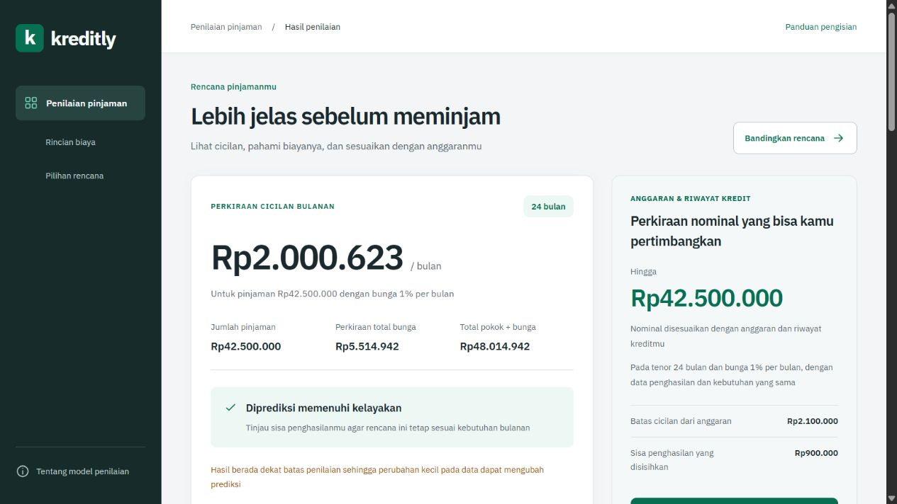

# Kreditly

Kreditly adalah Loan Eligibility Prediction App berbahasa Indonesia untuk tugas pengembangan aplikasi dan model
Isi penghasilan, pengeluaran, riwayat kredit, serta rencana pinjaman untuk melihat prediksi kelayakan, cicilan, biaya, dan nominal yang sesuai dengan profilmu

Aplikasi memakai Flask dan model lokal scikit-learn, seluruh nominal menggunakan rupiah
Model, dataset, dan antarmuka sudah ada di repo sehingga kamu bisa menjalankannya tanpa melatih ulang atau menyiapkan database

## Pilih yang kamu butuhkan

- [Baru pertama kali memasang](#instalasi-windows-dari-folder-kosong)
- [Menjalankan lagi atau mengambil pembaruan](#menjalankan-lagi-dan-mengambil-pembaruan)
- [Mengatasi error instalasi](#kalau-muncul-error)
- [Mengisi form dan membaca hasil](#mengisi-form)
- [Memahami cicilan dan nominal yang ditawarkan](#cara-menghitung-cicilan-dan-nominal)
- [Memahami model dan angka evaluasinya](#cara-kerja-model)
- [Mengubah kode atau menjalankan tes](#mengubah-kode)

## Contoh hasil



Gambar memakai profil Riwayat kredit baru, tenor 24 bulan, dan bunga 1% per bulan
Nominal Rp42.500.000 sudah melewati pemeriksaan anggaran dan model, lalu tetap dinilai layak ketika dikirim ulang dengan data yang sama

Hasil ini adalah prediksi aplikasi tugas, bukan persetujuan pinjaman dari bank
Model belajar dari data sintetis, bukan catatan peminjam Indonesia nyata

## Instalasi Windows dari folder kosong

Panduan ini memakai Windows 64-bit AMD64 dan Command Prompt atau CMD
Jalankan perintah satu per satu, jika ada error, berhenti pada langkah itu karena langkah berikutnya membutuhkan hasilnya

### 1) Pasang Git

Unduh [Git for Windows](https://git-scm.com/install/windows) dan pasang dengan pilihan bawaan
Setelah selesai, tutup terminal lama agar CMD berikutnya mengenali Git

### 2) Buka CMD di folder kosong

Buka folder kosong yang ingin kamu pakai lewat File Explorer
Klik kolom alamat folder di bagian atas, ketik `cmd`, lalu tekan Enter
CMD akan terbuka dengan folder tersebut sebagai lokasi kerja

Cek Git

```cmd
git --version
```

Lanjutkan jika muncul `git version` beserta nomor versinya

### 3) Ambil isi repo

```cmd
git clone https://github.com/Randevough/Kreditly.git .
```

Titik terakhir berarti isi repo masuk langsung ke folder yang sedang terbuka
Jalankan pada folder kosong agar tidak membuat susunan folder Kreditly di dalam Kreditly

Cek berkas aplikasi

```cmd
dir app.py
```

Harus terlihat `app.py`
Mulai langkah ini, jalankan semua perintah proyek dari folder yang berisi `app.py` dan `requirements.txt`

### 4) Pastikan Python 3.12 tersedia

Cek lokasi Python yang dipakai panduan ini

```cmd
"%LocalAppData%\Programs\Python\Python312\python.exe" --version
```

Jika hasilnya `Python 3.12.x`, lanjut ke langkah 5
Jika lokasi tidak ditemukan, unduh [installer resmi Python 3.12.10 untuk Windows 64-bit](https://www.python.org/downloads/release/python-31210/) dengan perintah berikut

```cmd
curl.exe -fL "https://www.python.org/ftp/python/3.12.10/python-3.12.10-amd64.exe" -o "%TEMP%\python-3.12.10-amd64.exe"
```

Setelah unduhan selesai, jalankan installer berikut dan tunggu jendela pemasangan selesai
Perintah ini memasang Python untuk pengguna Windows saat ini pada lokasi yang akan dipakai langkah berikutnya

```cmd
start /wait "" "%TEMP%\python-3.12.10-amd64.exe" /passive InstallAllUsers=0 Include_launcher=0 Include_test=0 PrependPath=0 TargetDir="%LocalAppData%\Programs\Python\Python312"
```

Cek lagi

```cmd
"%LocalAppData%\Programs\Python\Python312\python.exe" --version
```

Lanjutkan jika hasilnya `Python 3.12.x`
Jika kamu sudah memasang Python 3.12 di lokasi lain, gunakan lokasi `python.exe` instalasi tersebut

Python 3.15 boleh tetap terpasang, tetapi jangan memakainya untuk membuat lingkungan proyek ini
Pada kasus instalasi dengan Python 3.15, NumPy 2.2.6 mencoba dikompilasi dan gagal karena compiler tidak tersedia
Panduan ini memilih Python 3.12 agar cocok dengan paket dan model yang disertakan

### 5) Buat lingkungan Python proyek

```cmd
"%LocalAppData%\Programs\Python\Python312\python.exe" -m venv .venv312
```

Perintah ini membuat folder `.venv312`, biasanya tanpa pesan setelah selesai
Folder tersebut berisi Python dan paket khusus untuk Kreditly

Cek hasilnya sebelum memasang paket

```cmd
.\.venv312\Scripts\python.exe --version
```

Hasilnya harus `Python 3.12.x`
Kita memakai lokasi Python lengkap agar instalasi paket dan aplikasi selalu menggunakan Python yang sama, tanpa perlu mengaktifkan lingkungan lewat PowerShell

### 6) Pasang paket

```cmd
.\.venv312\Scripts\python.exe -m pip install --upgrade pip
```

```cmd
.\.venv312\Scripts\python.exe -m pip install --only-binary=:all: -r requirements.txt
```

Tunggu sampai selesai tanpa error
Opsi `--only-binary=:all:` meminta paket siap pakai agar pip tidak mencoba mengompilasi NumPy di komputer temanmu

Repo menetapkan Flask 3.1.3, NumPy 2.2.6, dan scikit-learn 1.7.2 di [requirements.txt](requirements.txt)
Jangan mengganti versinya hanya untuk melewati error instalasi, model tersimpan bergantung pada kecocokan versi scikit-learn

### 7) Jalankan aplikasi

```cmd
.\.venv312\Scripts\python.exe app.py
```

Tanda server sudah menyala

```text
Running on http://127.0.0.1:5000
```

Buka [http://127.0.0.1:5000](http://127.0.0.1:5000) di browser komputer yang sama
Biarkan CMD tetap terbuka selama memakai aplikasi, tekan `Ctrl+C` untuk menghentikannya
Alamat `127.0.0.1` mengarah ke komputer sendiri, teman di komputer lain perlu menjalankan salinan aplikasinya sendiri

Kamu tidak perlu Node.js, API key, akun bank, atau database untuk menjalankan aplikasi
Node.js hanya diperlukan jika ingin menjalankan tes JavaScript

<details>
<summary>macOS atau Linux dengan Python 3.12 yang sudah tersedia</summary>

Jalankan di terminal, terpisah dari panduan CMD Windows di atas

```sh
git clone https://github.com/Randevough/Kreditly.git
cd Kreditly
python3.12 -m venv .venv312
./.venv312/bin/python -m pip install --upgrade pip
./.venv312/bin/python -m pip install -r requirements.txt
./.venv312/bin/python app.py
```

Gunakan `./.venv312/bin/python` untuk perintah Python berikutnya pada sistem ini

</details>

## Menjalankan lagi dan mengambil pembaruan

Pemasangan paket cukup dilakukan saat setup awal, lalu diulang jika `requirements.txt` berubah

Untuk menjalankan lagi, buka folder yang berisi `app.py`, ketik `cmd` di kolom alamat File Explorer, lalu jalankan

```cmd
.\.venv312\Scripts\python.exe app.py
```

Untuk mengambil pembaruan, hentikan server dengan `Ctrl+C` dan jalankan

```cmd
git status --short
git pull --ff-only origin main
```

Jika `git status` menampilkan perubahan kode yang kamu buat, simpan pekerjaanmu dan periksa perubahan sebelum melanjutkan
Folder `.venv312/` bisa muncul sebagai berkas lokal yang belum dilacak, jangan masukkan lingkungan Python ke commit
Jika Git menolak pembaruan karena perubahan lokal atau cabang berbeda, berhenti dan baca pesannya, jangan menjalankan `git reset --hard` untuk menghilangkan error

Jika pembaruan mengubah `requirements.txt`, jalankan kembali

```cmd
.\.venv312\Scripts\python.exe -m pip install --only-binary=:all: -r requirements.txt
```

Nyalakan server lagi

```cmd
.\.venv312\Scripts\python.exe app.py
```

Tekan `Ctrl+F5` di browser untuk memuat CSS dan JavaScript terbaru
Server bawaan berjalan tanpa pemuatan ulang otomatis, jadi perubahan Python membutuhkan restart server

## Kalau muncul error

| Pesan atau gejala | Yang perlu dicek | Langkah berikutnya |
| --- | --- | --- |
| `git is not recognized` | Git belum tersedia di CMD tersebut | Pasang Git lalu tutup dan buka CMD lagi |
| `Python was not found` atau `py is not recognized` | Perintah umum mengarah ke instalasi atau alias yang berbeda | Gunakan lokasi Python 3.12 lengkap pada langkah 4 |
| `The system cannot find the path specified` saat memakai `.venv312` | Lokasi kerja salah atau lingkungan belum dibuat | Jalankan `dir app.py`, lalu ulangi langkah 5 dan cek versinya |
| `can't open file 'app.py'` | CMD berada di folder yang bukan folder aplikasi | Buka CMD dari folder yang berisi `app.py` |
| NumPy mengunduh `.tar.gz`, lalu `Unknown compiler(s)` | pip mencoba membuat paket dari kode sumber | Cek versi Python di `.venv312`, pakai Python 3.12 dan ulangi langkah pemasangan paket |
| `No matching distribution found` | Paket siap pakai tidak ditemukan untuk lingkungan tersebut | Cek versi dan arsitektur Python, jangan melanjutkan ke `app.py` sebelum pemasangan berhasil |
| `No module named 'flask'` | Pemasangan requirements gagal atau memakai Python lain | Ulangi langkah 6 dengan Python dari `.venv312`, bukan `pip` umum |
| Error saat membaca `model.pkl` atau peringatan versi scikit-learn | Model dan paket tidak cocok atau berkas model berubah | Pasang versi requirements dan gunakan model bawaan repo yang sama |
| Port 5000 sedang dipakai | Ada server lain yang masih menyala | Hentikan server Kreditly lama dengan `Ctrl+C`, atau pakai port lain di bawah |
| Tampilan masih versi lama | Browser menyimpan CSS atau JavaScript lama | Restart server dan tekan `Ctrl+F5` |
| `destination path ... already exists and is not an empty directory` | Folder tujuan clone sudah berisi berkas | Gunakan folder kosong lain, atau `git pull` jika folder itu memang clone repo ini |

Jika port 5000 dipakai aplikasi lain, dari folder proyek jalankan

```cmd
.\.venv312\Scripts\python.exe -m flask --app app run --port 5001
```

Lalu buka [http://127.0.0.1:5001](http://127.0.0.1:5001)
Peringatan bahwa Flask memakai development server memang muncul saat menjalankan server lokal ini

Untuk meminta bantuan, kirim perintah yang dijalankan, pesan error lengkap, dan hasil dua perintah berikut

```cmd
cd
.\.venv312\Scripts\python.exe -c "import sys, platform; print(sys.version); print(platform.machine())"
```

## Mengisi form

Nominal diisi dalam rupiah penuh, `8000000` otomatis tampil sebagai `8.000.000`
Input salin-tempel `Rp 8.000.000` juga didukung
Nominal rupiah harus bilangan bulat, sedangkan kolom bunga boleh memakai desimal

| Kolom | Cara mengisinya |
| --- | --- |
| Penghasilan bulanan | Rp2 juta sampai Rp40 juta per bulan |
| Penghasilan pendamping | Rp0 sampai Rp15 juta, isi 0 jika mengajukan sendiri |
| Jumlah pinjaman | Rp1 juta sampai Rp500 juta |
| Tenor pinjaman | Pilih 6, 12, 18, 24, 36, 48, atau 60 bulan |
| Bunga per bulan | 0 sampai 3%, nilai awal 1%, maksimal dua angka desimal |
| Cicilan berjalan | Total cicilan lain per bulan, Rp0 sampai Rp20 juta |
| Biaya hidup bulanan | Kebutuhan rutin di luar cicilan, Rp0 sampai Rp40 juta |
| Riwayat pembayaran kredit | Lancar, pernah menunggak, atau belum punya riwayat |

Masukkan cicilan pada kolom cicilan berjalan, bukan dihitung lagi sebagai biaya hidup
Jika kebutuhan rutin Rp3 juta sudah mencakup cicilan Rp500 ribu, masukkan biaya hidup Rp2,5 juta dan cicilan Rp500 ribu agar tidak dihitung dua kali

Bunga `0,75` atau `0.75` berarti 0,75% per bulan
Mengubah bunga memengaruhi cicilan dan fitur keuangan yang masuk ke model
Rentang 0 sampai 3% adalah batas input proyek, bukan batas regulasi atau rekomendasi tarif

Contoh profil membantu kamu mencoba alur tanpa mengetik semua data
Contoh profil mengisi data keuangan dan riwayat, tetapi mempertahankan bunga yang sedang dipilih
Gunakan bunga 1% jika ingin mencocokkan hasil dengan tabel berikut

| Profil | Cicilan baru per bulan | Sisa setelah kebutuhan dan seluruh cicilan | Prediksi | Nominal yang ditawarkan |
| --- | ---: | ---: | --- | ---: |
| Pengeluaran terjaga | Rp1.660.715 | Rp4.339.285 | Layak | Rp105.300.000 |
| Cicilan tinggi | Rp3.321.431 | -Rp2.821.431 | Belum layak | Tidak ada |
| Riwayat kredit baru | Rp1.882.939 | Rp1.317.061 | Layak | Rp42.500.000 |

Nominal pada tabel dibulatkan ke rupiah
Lihat [PRESENTATION.md](PRESENTATION.md) untuk urutan demo dan rincian profil

## Membaca hasil

| Bagian | Arti praktis |
| --- | --- |
| Prediksi kelayakan | Klasifikasi dari model lokal pada data yang kamu masukkan |
| Cicilan bulanan | Perkiraan pembayaran pokok dan bunga setiap bulan |
| Sisa penghasilan | Penghasilan gabungan dikurangi biaya hidup, cicilan berjalan, dan cicilan baru |
| Nominal yang bisa dipertimbangkan | Nominal terbesar dalam kelipatan Rp100 ribu yang memenuhi batas anggaran dan lolos model |
| Total pokok + bunga | Total pembayaran dari rumus cicilan, belum termasuk biaya lain |
| Perbandingan rencana | Perhitungan dan prediksi ulang untuk nominal lebih kecil atau tenor lebih panjang |

Riwayat kredit baru tidak otomatis ditolak, tetapi nominal yang lolos bisa berbeda dari profil dengan pembayaran lancar
Hasil dekat ambang keputusan bisa berubah setelah perubahan kecil pada data, aplikasi menampilkan catatan untuk kondisi tersebut

Sisa penghasilan pada halaman hasil belum dikurangi tabungan atau pengeluaran lain yang tidak kamu masukkan
Penjelasan anggaran merangkum perhitungan input, bukan penjelasan sebab akibat dari classifier

## Cara menghitung cicilan dan nominal

### Bunga atas sisa pokok

Kreditly memakai anuitas dengan cicilan tetap
Setiap bulan bunga dihitung dari pokok yang belum dibayar, sehingga bagian bunga mengecil dan bagian pembayaran pokok membesar

Contoh pinjaman Rp10 juta selama 12 bulan pada bunga 1% per bulan

| Perhitungan | Hasil sebelum biaya lain |
| --- | ---: |
| Cicilan per bulan | Sekitar Rp888.488 |
| Bunga bulan pertama | Rp100.000 |
| Pokok yang dibayar bulan pertama | Sekitar Rp788.488 |
| Sisa pokok setelah pembayaran pertama | Sekitar Rp9.211.512 |
| Bunga bulan kedua | Sekitar Rp92.115 |

Persentase yang sama dengan metode flat menghasilkan cicilan berbeda karena flat menghitung bunga dari pokok awal
Jika bunga diisi 0%, aplikasi membagi pokok dengan jumlah bulan dan menghitung total bunga nol
Pada bunga di atas 0%, tenor lebih panjang bisa menurunkan cicilan bulanan sambil menambah total bunga

Administrasi, provisi, asuransi, dan biaya lain belum diperhitungkan karena proyek tidak terhubung ke tarif pemberi pinjaman
Status belum diperhitungkan tidak berarti biayanya Rp0

### Nominal harus lolos dua pemeriksaan

Pertama, aplikasi menghitung ruang cicilan baru berdasarkan asumsi anggaran proyek

```text
penghasilan = penghasilan pemohon + penghasilan pendamping

batas dari rasio cicilan = 40% × penghasilan − cicilan berjalan
batas dari sisa kebutuhan = penghasilan − biaya hidup − cicilan berjalan − 15% × penghasilan

ruang cicilan baru = nilai terkecil dari kedua batas, dengan minimum nol
```

Aplikasi mengubah ruang cicilan menjadi batas pokok pinjaman pada tenor dan bunga yang dipilih
Batas ini dibulatkan turun ke kelipatan Rp100 ribu dan dibatasi sampai Rp500 juta
Angka 40% dan 15% adalah asumsi proyek, bukan kebijakan bank

Kedua, aplikasi memeriksa kandidat Rp1 juta sampai batas tersebut dengan model yang sama
Aplikasi menawarkan kandidat terbesar yang lolos prediksi pada riwayat kredit, tenor, bunga, dan data keuangan yang sama
Jika tidak ada kandidat yang memenuhi keduanya, tombol penggunaan nominal tidak muncul

Contoh yang membedakan keduanya adalah profil Riwayat kredit baru pada bunga 1% dan tenor 24 bulan

| Nominal | Hasil |
| --- | --- |
| Rp40.000.000 | Pinjaman awal, diprediksi layak |
| Rp44.600.000 | Masih masuk batas anggaran, tetapi diprediksi belum layak |
| Rp42.500.000 | Nominal terbesar dalam kelipatan Rp100 ribu yang lolos kedua pemeriksaan |

Klik Coba nominal ini lalu kirim ulang tanpa mengubah data, hasilnya tetap layak
Jika kamu mengubah bunga, tenor, penghasilan, pengeluaran, atau riwayat kredit, aplikasi perlu menilai kembali

Ringkasan form meminta pemeriksaan ke server setelah seluruh data valid
Saat data berubah, aplikasi menyembunyikan tombol penggunaan nominal sampai pemeriksaan terbaru selesai
Jika pemeriksaan gagal, aplikasi tidak menawarkan batas anggaran sebagai pengganti hasil model

## Cara kerja model

Alur aplikasi

```text
Form dalam rupiah dan bunga pilihan
  → validasi di browser dan server
  → perhitungan cicilan serta sisa penghasilan
  → empat fitur keuangan dan riwayat kredit
  → prediksi model lokal
  → hasil, rincian biaya, dan pemeriksaan kandidat nominal
```

| Fitur yang dibaca model | Yang dihitung |
| --- | --- |
| `DebtToIncomeRatio` | Seluruh cicilan dibagi penghasilan gabungan |
| `DisposableIncomeShare` | Sisa setelah kebutuhan dan seluruh cicilan dibagi penghasilan gabungan |
| `CreditArrears` | 1 jika pernah menunggak, selain itu 0 |
| `CreditHistoryClear` | 1 jika pembayaran lancar, selain itu 0 |

Riwayat baru memakai kedua indikator kredit bernilai 0
Gender, status pernikahan, pendidikan, dan lokasi tempat tinggal tidak masuk ke model

Model membaca beban pinjaman melalui rasio, jadi bunga tidak menjadi fitur mentah tambahan
Bunga naik → cicilan naik → sisa penghasilan turun → prediksi dapat berubah
Artifact model tidak dilatih ulang ketika pengguna mengubah bunga

### Data dan pemilihan model

[train_model.py](train_model.py) membuat 20.000 profil sintetis dengan seed 42
Generator menghasilkan label hipotetis dari rasio cicilan, sisa penghasilan, riwayat kredit, dan pengambilan sampel probabilistik
Label tidak berasal dari persetujuan atau pembayaran peminjam nyata

| Pembagian | Jumlah profil | Pemakaian |
| --- | ---: | --- |
| Train | 12.000 | Melatih model dasar |
| Calibration | 2.000 | Menyesuaikan probabilitas dengan kalibrasi sigmoid |
| Validation | 2.000 | Memilih kandidat berdasarkan log loss |
| Test | 4.000 | Mengukur kandidat terpilih |
| Audit tambahan | 5.000 | Pemeriksaan setelah pemilihan dengan seed 2026 |

Kandidat mencakup Logistic Regression, Random Forest dengan batas arah monoton, serta varian kalibrasi keduanya
Model terpilih adalah `logistic_regression_sigmoid`, dengan ambang keputusan 0,5
Kalibrasi menyesuaikan probabilitas pada data sintetis, bukan menambahkan data peminjam Indonesia

### Membaca angka evaluasi

| Angka dari model aktif | Cara membacanya |
| --- | --- |
| Akurasi test sintetis 94,525% | Proporsi prediksi yang cocok dengan label pada 4.000 profil test |
| Baseline kelas mayoritas 74,025% | Pembanding jika semua profil selalu diberi kelas yang paling sering muncul |
| Brier score test sekitar 0,03996 | Kesalahan probabilitas terhadap label, lebih kecil lebih baik |
| Log loss test sekitar 0,13113 | Penalti prediksi probabilitas yang salah, terutama ketika model terlalu yakin |

Akurasi test bukan peluang pengajuanmu disetujui bank
Metrik pelatihan memakai asumsi bunga 1% per bulan, pengujian bunga custom memeriksa perhitungan dan arah prediksi, belum membuktikan akurasi atau kalibrasi pada bunga lain

[MODEL_CARD.md](MODEL_CARD.md) memuat evaluasi lengkap, perbandingan kandidat, dan batasan, termasuk penggunaan ulang split test pada evaluasi versi sebelumnya
[model_metadata.json](model_metadata.json) menyimpan angka, kurva kalibrasi, serta identitas model yang bisa diperiksa langsung

## Mengubah kode

| Ingin mengubah | Mulai dari | Yang perlu dijaga |
| --- | --- | --- |
| Warna, ukuran, dan susunan komponen | [static/style.css](static/style.css) | Konsistensi form dan halaman hasil |
| Label dan susunan form | [templates/index.html](templates/index.html) | Nama input harus tetap cocok dengan server |
| Tampilan hasil dan biaya | [templates/result.html](templates/result.html) | Pisahkan biaya yang dihitung dari biaya yang belum diketahui |
| Contoh profil dan interaksi form | [static/app.js](static/app.js) | Nominal yang ditawarkan harus tetap diperiksa server |
| Format rupiah dan perhitungan browser | [static/money.mjs](static/money.mjs) | Hasil harus sama dengan perhitungan Python |
| Rumus cicilan dan batas anggaran | [loan_model.py](loan_model.py) | Sesuaikan perhitungan browser dan tes juga |
| Validasi, hasil prediksi, dan kandidat nominal | [app.py](app.py) | Gunakan data, model, dan ambang yang sama untuk nominal yang ditawarkan |
| Generator data dan pelatihan | [train_model.py](train_model.py) | Perbarui model, metadata, dataset, dan laporan bersama |

Rute `GET /` menampilkan form, `POST /` mengisi ulang form dari rencana pilihan
`POST /predict` menghasilkan halaman penilaian, sedangkan `POST /estimate` mengembalikan nominal yang sudah diperiksa anggaran dan model

[Dataset/kreditly_synthetic_idr.csv](Dataset/kreditly_synthetic_idr.csv) adalah dataset model aktif
Folder `legacy/` menyimpan dataset dan notebook asal sebagai arsip, aplikasi aktif tidak membacanya

### Menjalankan tes

Dari folder yang berisi `app.py`

```cmd
.\.venv312\Scripts\python.exe -m unittest discover -s tests -v
```

Tes Python memeriksa validasi, model asli, biaya, bunga custom, arah prediksi, dan alur penggunaan nominal yang ditawarkan sampai dikirim ulang

Jika Node.js tersedia, jalankan juga

```cmd
node --test tests/money.test.mjs
```

Tes JavaScript memeriksa parser rupiah, pengeditan angka, bunga desimal, dan perhitungan anggaran
Saat panduan ini diperbarui, suite berisi 31 tes Python dan 7 tes JavaScript, pengujian Python juga mencakup 168 kombinasi bunga, tenor, dan riwayat kredit
Tes yang lolos memastikan perilaku yang diperiksa, bukan bukti kelayakan kredit pada peminjam nyata

### Melatih ulang hanya saat mengubah model

Untuk menjalankan aplikasi biasa, gunakan `model.pkl` yang sudah disertakan
Jika memang ingin membentuk ulang data dan model, jalankan

```cmd
.\.venv312\Scripts\python.exe train_model.py
```

Perintah ini menulis ulang `model.pkl`, `model_metadata.json`, `Dataset/kreditly_synthetic_idr.csv`, dan `MODEL_CARD.md`
Periksa perubahan hasilnya dan jalankan tes sebelum memasukkannya ke commit
Muat hanya berkas pickle yang kamu percaya karena pemuatan pickle dapat menjalankan kode

## Penyimpanan data dan batas pemakaian

Kode aplikasi memproses isian pada server lokal dan tidak menulisnya ke database, localStorage, atau sessionStorage
Isian dikirim ke server untuk penilaian dan pemeriksaan nominal, lalu ikut dimuat kembali saat memilih rencana lain

Repo ini tidak terhubung ke bank, biro kredit, pembayaran, atau layanan persetujuan pinjaman
Pemakaian nyata membutuhkan data observasi berizin dan validasi pada peminjam nyata
Server Flask bawaan dalam panduan ini ditujukan untuk pengembangan lokal

## Lisensi dan atribusi

Kreditly dikembangkan dari [Loan Eligibility Prediction Web App](https://github.com/MohamedKhalidLx/Loan-Eligibility-Prediction-Web-App) oleh MohamedKhalidLx
Antarmuka, alur pengguna, perhitungan rupiah, dan model lokal dikembangkan lebih lanjut untuk Kreditly
Copyright dan lisensi MIT kode asal tetap ada di [LICENSE](LICENSE)
Font IBM Plex Sans memakai lisensi SIL Open Font License yang disertakan di [static/fonts/OFL.txt](static/fonts/OFL.txt)
